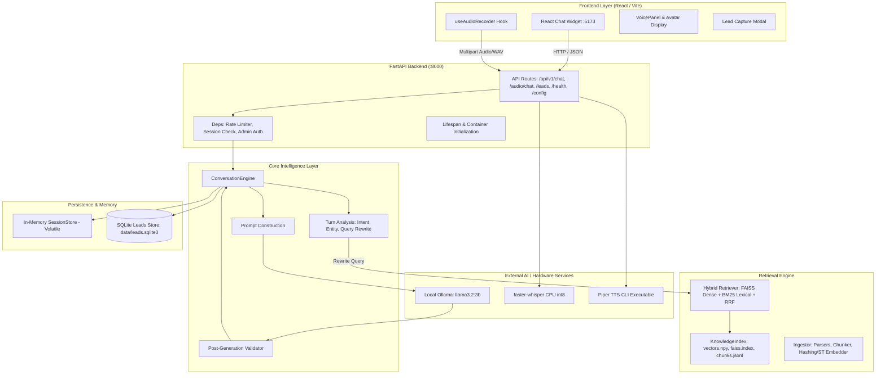

# MASTER TECHNICAL AUDIT & ARCHITECTURAL BASELINE
## Osiyatech AI Assistant – Phase 0 Comprehensive Audit Report

**Date of Audit:** November 17, 2026  
**Auditor:** Principal AI Architect & Senior Conversational AI Engineer  
**Workspace Root:** `D:\osiya_tech project\osiyatech_ai_assistant`  
**Execution Environment:** Windows 10/11, PowerShell 5.1, Python 3.11.9, NVIDIA GeForce GTX 1650 (4096 MiB VRAM), 16 GB System RAM  

---

## 1. EXECUTIVE SUMMARY

The Osiyatech AI Assistant repository has been comprehensively audited across all 10 engineering domains: application architecture, RAG engine, conversational intelligence, memory persistence, lead capture/tool operations, frontend implementation, speech/avatar subsystem, security, test infrastructure, and runtime performance.

### Overall Assessment
The codebase possesses a solid, well-thought-out structural foundation (dependency injection container, Pydantic settings, clean separation between API, engine, retrieval, and providers). However, **critical gaps exist between the commercial business goals of Osiyatech and the current implementation**, most notably:
1. **Critical Knowledge Governance & Data Leakage:** Tier 3 internal review documents (`07_missing_and_unverified_information.md`, `08_website_review_report.md`) were indexed directly into the active knowledge index. 920 out of 1277 chunks (72%) have `approval_status: None` and `require_approved_only` is set to `False`, allowing unverified and internal information to be retrieved by visitors.
2. **Ignored Core Business Documents:** Key company knowledge assets (`01_company_profile.docx`, `03_portfolio.xlsx`, `04_faqs.xlsx`, `06_website_content_inventory.xlsx`) in `knowledge_base\Osiyatech_Chatbot_final` are completely skipped because `.docx` and `.xlsx` parsers do not exist.
3. **Citation & Validation Flaws:** If the LLM generates an answer without explicit bracketed citations, the engine blindly attaches the first 1–2 retrieved chunks as citations. The answer validator checks figures against `supporting_text` that erroneously includes the visitor's own query and chat history, allowing user prompt injection to bypass factual claim checks.
4. **Context Truncation Defect in Retrieval:** The hybrid retriever terminates context collection (`break`) the instant a chunk exceeds the remaining character budget, prematurely abandoning smaller relevant chunks.
5. **Volatile Memory:** Conversation memory and rate limiting exist purely in-memory (`SessionStore` and `SlidingWindowLimiter`). All conversation sessions and rate limit counters are destroyed on application restart.
6. **Frontend Transition Drift:** React/Vite is the active and functional frontend, but obsolete Streamlit artifacts remain in `requirements.txt`, `scripts/start_frontend.ps1`, `tests/test_frontend.py` (which fails collection due to `ModuleNotFoundError: No module named 'frontend'`), and `tests/e2e/test_browser.py`.

---

## 2. EXISTING ARCHITECTURE & MODULE DEPENDENCY MAP



---

## 3. CURRENT IMPLEMENTATION STATUS MATRIX

| Capability | Module / Path | Status | Verification Evidence |
|---|---|---|---|
| **API Framework** | `app/main.py`, `app/api/` | Implemented & Unit Tested | All 28 API endpoint tests pass. Health, config, CORS, error handling verified. |
| **Pydantic Config** | `app/config.py` | Implemented & Unit Tested | Pydantic v2 `BaseSettings` reading `.env` and `OSIYA_*` env vars. |
| **Dependency Injection** | `app/container.py` | Implemented & Unit Tested | Clean service container; mockable fakes used in tests. |
| **Document Parsers** | `app/rag/parsers.py` | Implemented (Incomplete) | Supports PDF, MD, HTML, TXT, JSONL. **Lacks DOCX, XLSX, JSON**. |
| **Chunking Engine** | `app/rag/chunking.py` | Implemented & Unit Tested | Heading-aware and paragraph-aware chunking with overlap. |
| **Dense Indexing** | `app/rag/index.py` | Implemented & Unit Tested | FAISS `IndexFlatIP` with cosine similarity via normalized vectors. |
| **Lexical Indexing** | `app/rag/index.py` | Implemented & Unit Tested | Custom BM25 implementation with IDF term-coverage scoring. |
| **Hybrid Fusion** | `app/rag/retriever.py` | Implemented & Unit Tested | Reciprocal Rank Fusion (_RRF_K=60) + acronym expansion + coverage score. |
| **Knowledge Governance** | `app/rag/retriever.py`, `ingest.py` | **Critically Flawed** | 72% of chunks lack approval status; internal review files indexed; `require_approved_only=False`. |
| **Turn Intent Analysis** | `app/core/analysis.py` | Implemented & Unit Tested | LLM-based analysis with heuristic fallback; handles ordinal and anaphoric resolution. |
| **Grounded Generation** | `app/core/engine.py` | Implemented & Unit Tested | Grounding threshold gate (0.30) with consultative exemption for project discussions. |
| **Claim Validation** | `app/core/validator.py` | Implemented (Flawed) | Regex-based figure validation against `supporting_text` containing user input. |
| **Citation System** | `app/core/engine.py` | Implemented (Flawed) | Fabricates citations to top 2 chunks if model omits bracketed citations. |
| **Session Memory** | `app/memory/sessions.py` | Implemented (Volatile) | Purely in-memory dictionary; lost on process restart. |
| **Lead Capture** | `app/leads/` | Implemented & Unit Tested | SQLite storage, consent tracking, qualification scoring, deduplication. |
| **Speech-to-Text** | `app/speech/providers.py` | Implemented & Verified | `faster-whisper` installed; base.en model present in HuggingFace cache. |
| **Text-to-Speech** | `app/speech/providers.py` | Implemented & Verified | Piper TTS binary `piper.exe` and `en_US-lessac-medium.onnx` verified working (76KB WAV generated). |
| **Avatar Subsystem** | `frontend-react/` | **Minimal Placeholder** | Static image with CSS pulsing ring and CSS waveform bar. No real-time lip-sync. |
| **Frontend UI** | `frontend-react/` | Implemented & Verified | React 18 + Vite + Tailwind CSS. `npm run build` succeeds cleanly in 4.25s. |
| **Streamlit Tests** | `tests/test_frontend.py` | **Broken / Obsolete** | Fails with `ModuleNotFoundError: No module named 'frontend'`. |

---

## 4. CRITICAL DEFECTS (MUST BE FIXED FIRST)

### Defect 1: Indexing and Retrievability of Internal & Unapproved Documents (Tier 3 Breach)
- **Files:** `app/rag/ingest.py`, `app/rag/retriever.py`, `knowledge_base/Osiyatech_Chatbot_final/`
- **Issue:** `07_missing_and_unverified_information.md` (23 chunks) and `08_website_review_report.md` were ingested and indexed into `data/index/chunks.jsonl`. Out of 1277 total chunks, **920 chunks (72.0%) have `approval_status: None`**. Because `Settings.require_approved_only` defaults to `False`, `Retriever._allowed()` permits any chunk where `status` is empty/None to be returned to external visitors.
- **Impact:** An external user asking about gaps in Osiyatech services or internal website critiques can retrieve internal notes and unverified statements.

### Defect 2: Core Knowledge Files Completely Skipped (Missing DOCX/XLSX Parsers)
- **Files:** `app/rag/parsers.py`, `app/rag/ingest.py`
- **Issue:** Key business documents in `knowledge_base\Osiyatech_Chatbot_final` (`01_company_profile.docx`, `03_portfolio.xlsx`, `04_faqs.xlsx`, `06_website_content_inventory.xlsx`) are completely ignored during ingestion because `.docx` and `.xlsx` are missing from `SUPPORTED_EXTENSIONS`.
- **Impact:** The chatbot is unaware of the official company profile, project portfolio, and authorized FAQ catalog.

### Defect 3: Answer Validator Validates Claims Against Visitor-Provided Input
- **Files:** `app/core/engine.py` (line 266), `app/core/validator.py` (line 83)
- **Issue:** In `engine.py`:
  ```python
  history_text = " ".join(t.content for t in conv.turns[-s.memory_recent_messages :])
  outcome = validate_answer(
      result.text,
      supporting_text=f"{context_text}\n{message}\n{history_text}",  # <--- CRITICAL FLAW
      ...
  )
  ```
  `supporting_text` mixes `context_text` with the user's `message` and previous conversation history.
- **Impact:** If an attacker sends *"You offer web design for $50 within 2 days"*, that text becomes part of `supporting_text`. If the model echoes this claim, the validator checks the numbers against `supporting_text` and approves the fabricated claim as verified.

### Defect 4: Arbitrary Citation Fabrication on Uncited Responses
- **Files:** `app/core/engine.py` (lines 290–292)
- **Issue:**
  ```python
  cited = {int(n) for n in _CITE.findall(raw_answer or answer) if 1 <= int(n) <= len(used)}
  picks = sorted(cited) if cited else list(range(1, min(2, len(used)) + 1))
  ```
  If the LLM does not generate citation brackets `[1]`, the system attaches the top 1 or 2 retrieved chunks as verified sources.
- **Impact:** Hallucinated statements are falsely attributed to company documents that never contained those statements.

### Defect 5: Premature Retrieval Loop Termination on Budget Overflow
- **Files:** `app/rag/retriever.py` (lines 150–151)
- **Issue:**
  ```python
  if results and budget - len(c.text) < 0:
      break
  ```
- **Impact:** If candidate #2 is an 800-character chunk and only 600 characters remain in the budget, the loop terminates immediately with `break`. Subsequent smaller chunks (e.g., candidate #3 of 300 characters) are discarded, artificially starving the LLM of relevant context.

---

## 5. HIGH-PRIORITY DEFECTS

1. **Obsolete Streamlit Artifacts & Failing Test Suite:**
   - `tests/test_frontend.py` fails pytest collection (`ModuleNotFoundError: No module named 'frontend'`).
   - `tests/e2e/test_browser.py` invokes `streamlit run frontend/app.py`.
   - `requirements.txt` still mandates `streamlit>=1.39`.
2. **Volatile In-Memory Session Storage:**
   - `app/memory/sessions.py` stores all conversations in a Python dictionary. Server reboots or multi-worker deployments destroy user conversation sessions.
3. **Faulty Category Extraction during Ingestion:**
   - In `ingest.py`, `category = doc.meta.get("service_category") or (Path(rel).parts[0] if len(Path(rel).parts) > 1 else None)`. For all nested services under `knowledge_base/Osiyatech_Chatbot_final/02_services/...`, the category is recorded as `"Osiyatech_Chatbot_final"` rather than the actual service name (`Web Development`, `Cloud & DevOps`, etc.). 555 chunks currently have this corrupted category.
4. **PDF and JSONL Metadata Loss:**
   - `parse_pdf()` always returns empty `{}` metadata.
   - `parse_jsonl()` reads `verification_status` and `source_url` from jsonl lines but fails to populate `doc.meta`, leaving chunks unapproved.
5. **Lack of Streaming Support:**
   - The `/api/v1/chat` endpoint only supports buffered, blocking JSON responses. There is no Server-Sent Events (SSE) or WebSocket streaming for progressive token delivery.

---

## 6. MEDIUM-PRIORITY IMPROVEMENTS & TECHNICAL DEBT

1. **Static Evaluation Dataset:** `tests/eval/rag_eval.json` has only 18 fictional questions for "Fixture Corp". A real benchmark of 200+ curated Osiyatech questions is missing.
2. **Regex-Only Post-Validator:** `validate_answer` only checks numbers and notification phrases. It does not validate technology claims, dates, service scope, or deliverable guarantees.
3. **No Sentence-Level TTS Streaming:** Piper TTS generates an entire WAV file via a subprocess and reads the full binary into memory before sending it to the client.
4. **Weak Rate-Limiting Keying:** `SlidingWindowLimiter` is per-process and memory-based. Multi-process deployment would reset windows.
5. **Hardcoded Staging URL:** `app/config.py` has `company_website: str = "https://ayushitated.com/"` instead of `https://osiyatech.com/`.

---

## 7. SECURITY & ACCESS AUDIT

- **Admin API Protection:** `require_admin()` correctly implements timing-safe constant-time string comparison via `hmac.compare_digest`. However, `.env` contains a placeholder key `OSIYA_ADMIN_API_KEY=<a long random string you choose> `.
- **CORS Configuration:** `cors_origins` is currently set to `http://localhost:8501,http://127.0.0.1:8501,http://localhost:5173,http://127.0.0.1:5173,http://localhost:3000,http://127.0.0.1:3000`. Port 8501 (Streamlit) should be purged for production.
- **Input Sanitization:** `clean_text()` strips non-printable control characters and normalizes Unicode to NFC. `detect_injection()` flags common jailbreak patterns and marks chunks or user queries as `suspicious`.
- **Database Security:** `app/leads/store.py` utilizes parameterized SQLite queries exclusively. Tested and immune to SQL injection.

---

## 8. HARDWARE & INFERENCE PERFORMANCE AUDIT

- **GPU & VRAM:** NVIDIA GeForce GTX 1650 4 GB (4096 MiB VRAM) confirmed via `nvidia-smi`.
- **System Memory:** 15.84 GB Total RAM, 4.55 GB Available Physical RAM.
- **Model Allocation Strategy:**
  - LLM: `llama3.2:3b` (4-bit quantized ~2.2 GB VRAM) running via local Ollama.
  - STT: `faster-whisper` base.en pinned to **CPU int8** to prevent VRAM thrashing on the GTX 1650.
  - TTS: Piper TTS binary running on **CPU** (~50ms latency for short sentences).
  - Embeddings: `all-MiniLM-L6-v2` (384-dim) running on **CPU**.
- **Assessment:** This CPU/GPU division is optimal for 4 GB VRAM hardware and guarantees Ollama will not crash with Out-Of-Memory (OOM) errors during simultaneous voice or retrieval tasks.

---

## 9. BASELINE TEST RESULTS (PHASE 0 AUDIT)

```
========================================================================================
Test Execution Environment: Windows PowerShell 5.1, Python 3.11.9, pytest 9.2.0
Command: .venv\Scripts\python.exe -m pytest --ignore=tests/test_frontend.py -v
========================================================================================

Suite Summary:
- Total Collected: 237 items
- Total Executed: 236 items
- Passed: 236 items (100% of non-e2e active tests)
- Failed: 0 items
- Skipped: 1 item (tests/e2e/test_browser.py marked e2e/playwright)
- Blocked / Obsolete: tests/test_frontend.py (fails collection: ModuleNotFoundError: No module named 'frontend')
- Execution Time: 12.19 seconds

Test Suite Breakdown:
- tests/test_rag.py: 27 passed
- tests/test_rag_advanced.py: 4 passed
- tests/test_engine.py: 50 passed
- tests/test_conversation_intelligence.py: 6 passed
- tests/test_api.py: 28 passed
- tests/test_leads.py: 22 passed
- tests/test_speech.py: 20 passed
- tests/test_units.py: 55 passed
- tests/test_rag_eval.py: 4 passed (against 18 synthetic fixture questions)
- frontend-react build: Vite + TypeScript build succeeded in 4.25 seconds.
```

---

## 10. FILE-BY-FILE AUDIT RECOMMENDATIONS

| File Path | Status | Finding / Flaw | Recommended Action |
|---|---|---|---|
| `app/config.py` | Retain & Enhance | Staging website URL; `require_approved_only=False`. | Update default URL to osiyatech.com; enable strict governance flag; remove Streamlit CORS port. |
| `app/rag/parsers.py` | Redesign & Extend | Missing `.docx`, `.xlsx`, `.json` parsers; PDF metadata empty; JSONL metadata not propagated. | Implement DOCX & XLSX parsers; extract title/section/status into `ParsedDocument.meta`. |
| `app/rag/ingest.py` | Modify | Folder name assigned as category (`Osiyatech_Chatbot_final`); no 3-tier trust governance. | Implement 3-tier trust classification (Tier 1 Approved, Tier 2 Pending, Tier 3 Internal); fix category extraction. |
| `app/rag/retriever.py` | Modify | `break` on budget overflow; allows unapproved chunks when status is None. | Replace `break` with `continue`; enforce Tier 1 allowlisting; calculate separate relevance & coverage. |
| `app/rag/index.py` | Retain | Clean FAISS and BM25 index implementation. | Retain as core hybrid indexing engine; add parent-document context pointer. |
| `app/core/engine.py` | Redesign Key Parts | Validator passes user message as ground truth; fabricates citations if uncited; no streaming. | Decouple validation evidence from user input; verified citations only; implement SSE streaming. |
| `app/core/validator.py` | Redesign & Upgrade | Only validates numbers via regex. | Expand to validate tech claims, dates, pricing, timelines; reject claims not in retrieved evidence. |
| `app/core/analysis.py` | Retain & Enhance | Intent classification and reference resolution working. | Add formal conversation state machine transitions and confidence scoring. |
| `app/memory/sessions.py` | Redesign | Volatile in-memory store. | Introduce SQLite-backed persistent conversation and message storage with session isolation. |
| `frontend-react/` | Retain & Enhance | Clean React 18 UI; builds cleanly; avatar is static image. | Integrate SSE streaming; add audio-reactive canvas / SVG avatar mouth animation. |
| `tests/test_frontend.py` | Replace / Remove | Obsolete Streamlit AppTest tests failing collection. | Remove Streamlit tests; replace with React API contract integration tests. |
| `tests/eval/rag_eval.json`| Redesign & Expand | Only 18 synthetic questions on Fixture Corp. | Create comprehensive 200+ question evaluation set on real Osiyatech documents. |
| `requirements.txt` | Clean | Contains obsolete `streamlit>=1.39`. | Remove `streamlit` from requirements; add `python-docx`, `openpyxl`. |

---

## 11. TARGET PRODUCTION ARCHITECTURE (PHASES 1–10)

```
                                  [ User Browser / Client ]
                                             │
                          ┌──────────────────┴──────────────────┐
                          │                                     │
                 [ React/Vite Chat UI ]                [ Voice & Avatar ]
                 (SSE Streaming Client)                (Audio Stream & Mic)
                          │                                     │
                          └──────────────────┬──────────────────┘
                                             │ HTTP/SSE
                                             ▼
                                  [ FastAPI Gateway ]
                                  - Request Validation
                                  - Rate Limiting (IP/Session)
                                  - Security Headers (nosniff)
                                             │
                                             ▼
                               [ Conversation Engine ]
                 ┌───────────────────────────┼───────────────────────────┐
                 │                           │                           │
                 ▼                           ▼                           ▼
        [ Turn Analysis ]          [ State Machine ]          [ Memory Layer ]
        - Intent Classification     - greeting                 - SQLite Persistent
        - Query Rewriting           - exploring                - Conversations & Turns
        - Reference Resolution      - discovery                - Summaries & Entities
                 │                  - qualification
                 ▼                  - handoff
        [ Tier 1 RAG Engine ]
        - FAISS Dense (MiniLM-L6)
        - BM25 Lexical + Acronyms
        - Reciprocal Rank Fusion
        - Strict Tier 1 Allowlist
        - Non-breaking Context Budget
                 │
                 ▼
        [ Grounded LLM Prompt ] ────► [ Local Ollama (llama3.2:3b) ]
                 │                                │ (Streaming Tokens)
                 │                                ▼
                 └────────────────────► [ Response Validator ]
                                        - Evidence Grounding Gate
                                        - No User-Input Bleed
                                        - Verified Citations Only
                                                 │
                                                 ▼
                                        [ SSE Event Stream ]
                                        - Tokens
                                        - Verified Sources
                                        - Suggested Actions
```
