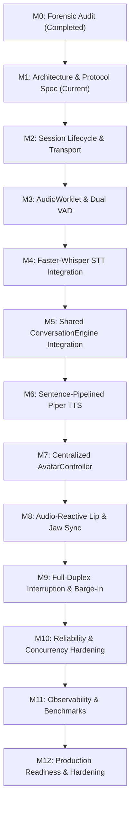

# Voice Implementation Roadmap & Milestone Plan

**Project:** Osiyatech AI Assistant — Real-Time Voice & Avatar Intelligence  
**Document Version:** 1.1.0  
**Status:** M1 Finalized Specification  

---

## 1. Milestone Roadmap Overview

---

## 2. Detailed Milestone Specifications

### Milestone M0: Codebase Forensic Audit (COMPLETED)
- **Status:** Complete & Verified.
- **Evidence:** 7 audit documents generated in `docs/`. Zero application code modified.

### Milestone M1: Architecture and Protocol Specification (CURRENT)
- **Status:** In Progress / Awaiting Approval.
- **Deliverables:**
  - Complete 13-state deterministic Finite State Machine.
  - Full WebSocket protocol specification with binary audio headers and JSON signaling.
  - Python Pydantic models & TypeScript interfaces.
  - Piper TTS benchmark and subprocess lifecycle analysis.
  - Dual-tier VAD architecture (Client Worklet + Server Segmenter).
  - Avatar visual state specifications and distinction between amplitude-driven animation vs. phoneme/viseme lip-sync.
  - Zero application code modified.

### Milestone M2: Session Lifecycle & Persistent WebSocket Transport
- **Goal:** One-click start, microphone permission request, persistent WebSocket connection, clean one-click stop.
- **Planned File Changes:**
  - Create `app/api/ws.py` (FastAPI WebSocket route handler).
  - Create `frontend-react/src/services/voiceSocket.ts` (WebSocket transport manager).
  - Update `app/main.py` (mount WebSocket router).
- **Verification Gate:**
  - Client connects with `session_id`, receives `session.ready`.
  - Closing session releases microphone immediately (100% track cleanup).
  - Reconnection backoff tested by severing server connection.

### Milestone M3: Audio Capture, AudioWorklet & Dual VAD
- **Goal:** Real-time 16kHz PCM audio capture and voice activity detection without UI jank.
- **Planned File Changes:**
  - Create `frontend-react/public/audio-processor.worklet.js` (Web Audio AudioWorklet).
  - Create `app/speech/vad.py` (Server-side PCM framer, pre-roll buffer, 700ms endpointing).
  - Update `frontend-react/src/hooks/useContinuousVoice.ts`.
- **Verification Gate:**
  - 50ms PCM binary frames streamed continuously over WebSocket.
  - VAD accurately emits `speech.started` and `speech.ended` on real speech.
  - Silence, typing sounds, and short coughs (<200ms) are discarded.

### Milestone M4: Faster-Whisper Speech Recognition Integration
- **Goal:** Transcribe endpointed utterance buffers using existing faster-whisper.
- **Planned File Changes:**
  - Update `app/speech/streaming.py` to pipe memory buffers to `FasterWhisperSTT.transcribe_sync`.
- **Verification Gate:**
  - Accurate English and Indian English speech transcription.
  - Utterances exceeding timeout or with low confidence trigger polite repeat queries without crashing.

### Milestone M5: Shared ConversationEngine Integration
- **Goal:** Connect transcripts into the shared conversation brain.
- **Planned File Changes:**
  - Connect `streaming.py` to `c.engine.handle(ChatRequest(..., interaction_mode="avatar"))`.
- **Verification Gate:**
  - Multi-turn follow-ups resolve seamlessly ("Tell me about AI services" -> "What are the benefits?").
  - Grounded citations stripped for voice, business rules and lead qualification updated in SQLite.

### Milestone M6: Sentence-Pipelined Piper TTS Streaming
- **Goal:** Stream assistant voice output with sub-second Time-to-First-Audio (TTFA).
- **Planned File Changes:**
  - Implement sentence boundary detector in `app/speech/streaming.py`.
  - Stream binary WAV audio chunks for Sentence 0 immediately, synthesize Sentence 1..K in parallel.
  - Update `voiceSocket.ts` to decode binary packets with 8-byte headers.
- **Verification Gate:**
  - TTFA measured at 500ms - 800ms.
  - Web Audio player queues sentences gaplessly without audio clicks or drops.

### Milestone M7: Avatar State Controller & Visual Intelligence
- **Goal:** Upgrade static avatar into an expressive, state-aware conversational persona.
- **Planned File Changes:**
  - Create `frontend-react/src/components/AvatarController.tsx`.
- **Verification Gate:**
  - Seamless visual transitions across `IDLE`, `LISTENING`, `THINKING`, `SPEAKING`, and `ERROR`.
  - Continuous micro-animations (breathing, blinking, head tilt) without React re-render performance drops.

### Milestone M8: Audio-Reactive Lip & Jaw Synchronization
- **Goal:** Synchronize avatar mouth and jaw movements to real-time audio playback.
- **Planned File Changes:**
  - Connect Web Audio `AnalyserNode` to canvas/SVG deformation in `AvatarController.tsx`.
- **Verification Gate:**
  - Mouth opens proportionally to vocal volume and pauses naturally during silence.
  - Decay smoothing prevents jitter.

### Milestone M9: Full-Duplex Interruption & Barge-In
- **Goal:** Enable user to speak while assistant is speaking to immediately take over the floor.
- **Planned File Changes:**
  - Implement instant client-side mute and `assistant.interrupt` signal.
  - Implement server-side task cancellation token and Piper subprocess kill.
- **Verification Gate:**
  - User speech stops assistant playback in <100ms.
  - Server invalidates pending chunks; new turn receives fresh answer without stale audio leakage.

### Milestone M10: Concurrency, Reliability & Error Recovery
- **Goal:** Harden the system against dropped connections, browser refreshes, and long sessions.
- **Verification Gate:**
  - 30-turn continuous dialogue completed with zero memory leak.
  - Text chat tested concurrently to verify zero regression.

### Milestone M11: Observability & Latency Benchmarks
- **Goal:** Measure and record p50, p90, and p95 latencies across all components.

### Milestone M12: Production Readiness, Security Review & Operational Runbook
- **Goal:** Final deployment documentation, secret scrubbing, origin verification, and rollback scripts.
