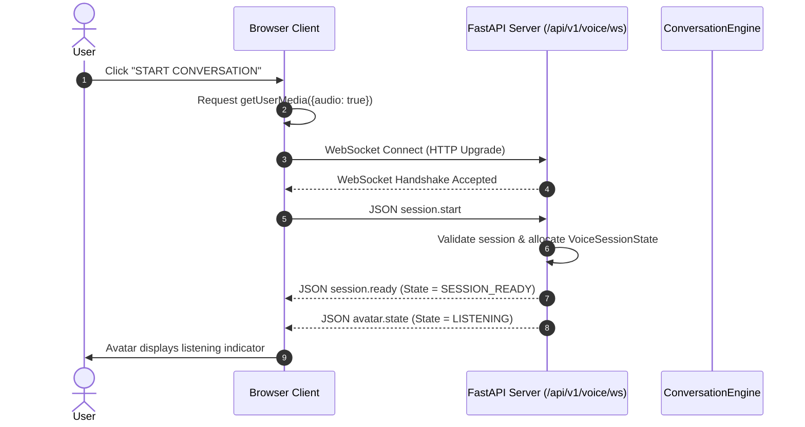
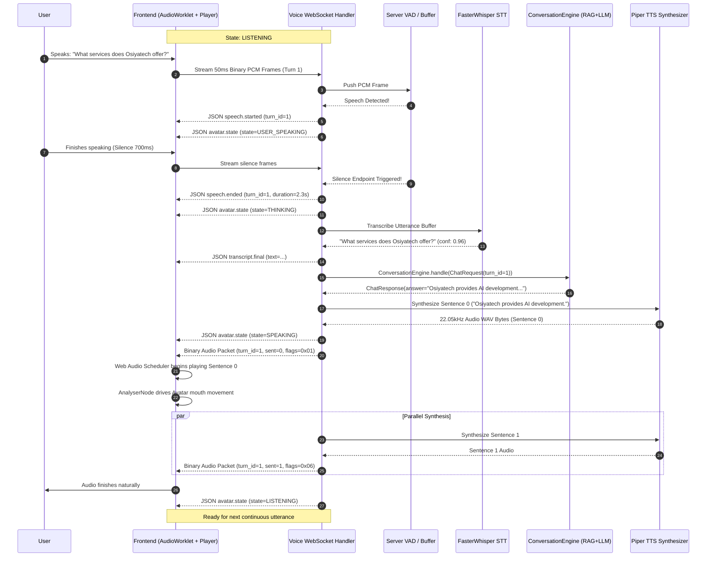

# Voice Protocol Specification (WebSocket v1)

**Version:** 1.1.0  
**Status:** M1 Finalized Specification  
**Transport:** WebSocket (`ws://` / `wss://`)  
**Path:** `/api/v1/voice/ws`  
**Wire Formats:** UTF-8 JSON (Control & Metadata) and Binary Frames (Linear PCM Audio)

---

## 1. Connection Handshake & Authentication

### 1.1 Endpoint URL
```
ws://<HOST>:<PORT>/api/v1/voice/ws?session_id=<SESSION_ID>&conversation_id=<CONVERSATION_ID>
```
- Query Parameters:
  - `session_id` (string, required): 16-64 alphanumeric characters. Validated against SessionStore.
  - `conversation_id` (string, optional): If provided, resumes active multi-turn context.

### 1.2 Handshake Sequence


---

## 2. Binary Audio Framing Specification

Audio is transported bidirectionally as binary WebSocket messages to prevent base64 serialization overhead.

### 2.1 Upstream (Client to Server: Microphone Audio)
- **Format:** Linear PCM, 16-bit Signed Integer, Little-Endian (`pcm_s16le`).
- **Sample Rate:** 16,000 Hz.
- **Channels:** 1 (Mono).
- **Frame Duration:** 50 ms.
- **Frame Size:** 800 samples = **1,600 bytes** per WebSocket binary frame.
- **No Header:** Pure PCM bytes streamed directly from AudioWorklet.

### 2.2 Downstream (Server to Client: Synthesized Speech)
To support multi-sentence pipelining and turn correlation, server audio packets include an 8-byte binary protocol header:

```
 0                   1                   2                   3
 0 1 2 3 4 5 6 7 8 9 0 1 2 3 4 5 6 7 8 9 0 1 2 3 4 5 6 7 8 9 0 1
+-+-+-+-+-+-+-+-+-+-+-+-+-+-+-+-+-+-+-+-+-+-+-+-+-+-+-+-+-+-+-+-+
|                           Turn ID                             |  (Bytes 0-3: uint32 BE)
+-+-+-+-+-+-+-+-+-+-+-+-+-+-+-+-+-+-+-+-+-+-+-+-+-+-+-+-+-+-+-+-+
|         Sentence Index        |             Flags             |  (Bytes 4-5: uint16, Bytes 6-7: uint16)
+-+-+-+-+-+-+-+-+-+-+-+-+-+-+-+-+-+-+-+-+-+-+-+-+-+-+-+-+-+-+-+-+
|                                                               |
|                       Audio Payload Data                      |  (Bytes 8+: 22,050 Hz 16-bit Mono WAV/PCM)
|                                                               |
+-+-+-+-+-+-+-+-+-+-+-+-+-+-+-+-+-+-+-+-+-+-+-+-+-+-+-+-+-+-+-+-+
```
- **Turn ID (uint32):** Current dialogue turn. Packets with `turn_id < client_turn_id` are discarded.
- **Sentence Index (uint16):** Index of sentence within answer (0, 1, 2...).
- **Flags (uint16 bitmask):**
  - `0x0001`: `IS_FIRST_CHUNK` (Initial audio for this sentence).
  - `0x0002`: `IS_SENTENCE_END` (Final audio chunk for this sentence).
  - `0x0004`: `IS_TURN_END` (Final audio chunk for the entire assistant turn).

---

## 3. Python Pydantic Event Schemas

Below are the exact Pydantic v2 schemas governing server-side serialization and validation:

```python
# app/schemas_voice.py
from __future__ import annotations
from typing import Literal
from pydantic import BaseModel, Field

# ------------------------------------------------------------- Upstream Events (Client -> Server)
class ClientSessionStart(BaseModel):
    type: Literal["session.start"] = "session.start"
    protocol_version: str = "1.0"
    sample_rate: int = 16000
    channels: int = 1
    frame_ms: int = 50

class ClientAssistantInterrupt(BaseModel):
    type: Literal["assistant.interrupt"] = "assistant.interrupt"
    turn_id: int
    client_timestamp: float

class ClientSessionPing(BaseModel):
    type: Literal["session.ping"] = "session.ping"
    client_timestamp: float

class ClientSessionStop(BaseModel):
    type: Literal["session.stop"] = "session.stop"
    client_timestamp: float

# ------------------------------------------------------------- Downstream Events (Server -> Client)
class ServerSessionReady(BaseModel):
    type: Literal["session.ready"] = "session.ready"
    session_id: str
    conversation_id: str
    server_timestamp: float

class ServerAvatarState(BaseModel):
    type: Literal["avatar.state"] = "avatar.state"
    state: Literal[
        "IDLE", "CONNECTING", "LISTENING", "USER_SPEAKING",
        "THINKING", "SPEAKING", "INTERRUPTED", "ERROR"
    ]
    turn_id: int | None = None

class ServerSpeechStarted(BaseModel):
    type: Literal["speech.started"] = "speech.started"
    turn_id: int
    timestamp: float

class ServerSpeechEnded(BaseModel):
    type: Literal["speech.ended"] = "speech.ended"
    turn_id: int
    duration_s: float

class ServerTranscriptPartial(BaseModel):
    type: Literal["transcript.partial"] = "transcript.partial"
    turn_id: int
    text: str

class ServerTranscriptFinal(BaseModel):
    type: Literal["transcript.final"] = "transcript.final"
    turn_id: int
    text: str
    confidence: float | None = None
    language: str | None = None

class ServerAssistantThinking(BaseModel):
    type: Literal["assistant.thinking"] = "assistant.thinking"
    turn_id: int

class ServerAssistantTextChunk(BaseModel):
    type: Literal["assistant.text.chunk"] = "assistant.text.chunk"
    turn_id: int
    sentence_idx: int
    text: str
    is_final_sentence: bool = False

class ServerAssistantInterrupted(BaseModel):
    type: Literal["assistant.interrupted"] = "assistant.interrupted"
    turn_id: int
    timestamp: float

class ServerSessionPong(BaseModel):
    type: Literal["session.pong"] = "session.pong"
    client_timestamp: float
    server_timestamp: float

class ServerSessionError(BaseModel):
    type: Literal["session.error"] = "session.error"
    code: str
    message: str
    turn_id: int | None = None
    retryable: bool = False
```

---

## 4. Matching TypeScript Interfaces

Below are the corresponding TypeScript interface declarations for the React frontend:

```typescript
// frontend-react/src/types/voiceProtocol.ts

export type VoiceSessionState =
  | 'IDLE'
  | 'REQUESTING_PERMISSION'
  | 'CONNECTING'
  | 'SESSION_READY'
  | 'LISTENING'
  | 'USER_SPEAKING'
  | 'PROCESSING'
  | 'ASSISTANT_SPEAKING'
  | 'INTERRUPTING'
  | 'RECONNECTING'
  | 'ERROR'
  | 'TERMINATING'
  | 'TERMINATED';

export type AvatarVisualState =
  | 'IDLE'
  | 'CONNECTING'
  | 'LISTENING'
  | 'USER_SPEAKING'
  | 'THINKING'
  | 'SPEAKING'
  | 'INTERRUPTED'
  | 'ERROR';

// ------------------------------------------------------------- Client -> Server
export interface ClientSessionStartMessage {
  type: 'session.start';
  protocol_version: '1.0';
  sample_rate: number;
  channels: number;
  frame_ms: number;
}

export interface ClientAssistantInterruptMessage {
  type: 'assistant.interrupt';
  turn_id: number;
  client_timestamp: number;
}

export interface ClientSessionPingMessage {
  type: 'session.ping';
  client_timestamp: number;
}

export interface ClientSessionStopMessage {
  type: 'session.stop';
  client_timestamp: number;
}

export type ClientVoiceMessage =
  | ClientSessionStartMessage
  | ClientAssistantInterruptMessage
  | ClientSessionPingMessage
  | ClientSessionStopMessage;

// ------------------------------------------------------------- Server -> Client
export interface ServerSessionReadyMessage {
  type: 'session.ready';
  session_id: string;
  conversation_id: string;
  server_timestamp: number;
}

export interface ServerAvatarStateMessage {
  type: 'avatar.state';
  state: AvatarVisualState;
  turn_id?: number;
}

export interface ServerSpeechStartedMessage {
  type: 'speech.started';
  turn_id: number;
  timestamp: number;
}

export interface ServerSpeechEndedMessage {
  type: 'speech.ended';
  turn_id: number;
  duration_s: number;
}

export interface ServerTranscriptPartialMessage {
  type: 'transcript.partial';
  turn_id: number;
  text: string;
}

export interface ServerTranscriptFinalMessage {
  type: 'transcript.final';
  turn_id: number;
  text: string;
  confidence: number | null;
  language: string | null;
}

export interface ServerAssistantThinkingMessage {
  type: 'assistant.thinking';
  turn_id: number;
}

export interface ServerAssistantTextChunkMessage {
  type: 'assistant.text.chunk';
  turn_id: number;
  sentence_idx: number;
  text: string;
  is_final_sentence: boolean;
}

export interface ServerAssistantInterruptedMessage {
  type: 'assistant.interrupted';
  turn_id: number;
  timestamp: number;
}

export interface ServerSessionPongMessage {
  type: 'session.pong';
  client_timestamp: number;
  server_timestamp: number;
}

export interface ServerSessionErrorMessage {
  type: 'session.error';
  code: string;
  message: string;
  turn_id?: number;
  retryable: boolean;
}

export type ServerVoiceMessage =
  | ServerSessionReadyMessage
  | ServerAvatarStateMessage
  | ServerSpeechStartedMessage
  | ServerSpeechEndedMessage
  | ServerTranscriptPartialMessage
  | ServerTranscriptFinalMessage
  | ServerAssistantThinkingMessage
  | ServerAssistantTextChunkMessage
  | ServerAssistantInterruptedMessage
  | ServerSessionPongMessage
  | ServerSessionErrorMessage;
```

---

## 5. End-to-End Dialogue Sequence


