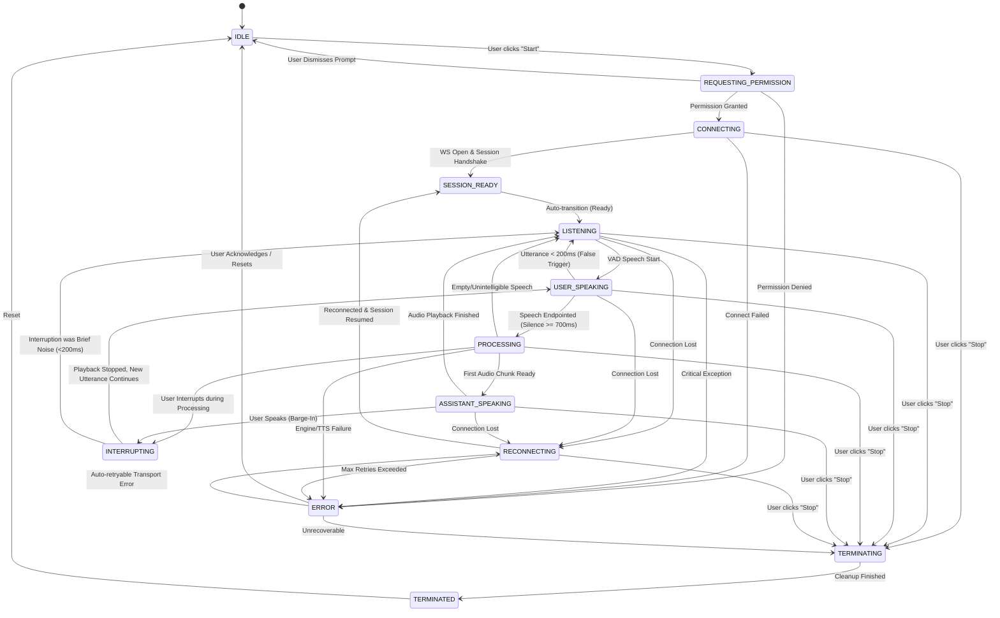

# Voice Target Architecture — Osiyatech AI Assistant

**Document Version:** 1.1.0  
**Status:** M1 Finalized Specification  
**Author:** Principal AI Architect / Senior Real-Time Systems Engineer  

---

## 1. Architectural Blueprint

The target architecture upgrades the Osiyatech AI Assistant into a real-time, continuous, full-duplex conversational voice avatar while strictly preserving all existing conversational intelligence, RAG pipelines, and API contracts.

```
+====================================================================================================+
|                                    LAYER 1: BROWSER USER INTERFACE                                 |
|                                                                                                    |
|  [ One-Click Start / Stop Controls ]               [ Real-Time Conversation Dialogue & Tracing ]   |
|  - "START CONVERSATION" (Single Click)             - Live Partial & Final User Transcripts         |
|  - "STOP SESSION" (Instant Idempotent Teardown)    - Grounded Assistant Message History            |
|                                                    - Sources, Confidence & Suggested Actions       |
|                                                                                                    |
|  [ High-Performance Audio Engine ]                 [ Centralized Avatar State Controller ]         |
|  - Web Audio Context (16kHz Native Pipeline)       - requestAnimationFrame Render Loop             |
|  - AudioWorklet (Microphone Ingestion)             - States: IDLE, LISTENING, THINKING, SPEAKING   |
|  - Streaming Audio Queue (Gapless Playback)        - Audio-Reactive Mouth & Jaw Animation          |
|  - AnalyserNode (FFT & RMS Spectral Extractor)     - Instant Barge-In Snap to Attentive Stance     |
+==================================================▲=================================================+
                                                   │
                   WebSocket /api/v1/voice/ws (Persistent Full-Duplex Binary & JSON)
                                                   │
+==================================================▼=================================================+
|                                  LAYER 2: REAL-TIME TRANSPORT LAYER                                |
|                                                                                                    |
|  - Multiplexed Transport: Binary PCM Audio (Frames & Chunks) + Structured JSON Signaling           |
|  - Turn Correlation: Monotonically Increasing turn_id for Stale Packet Discard                    |
|  - Heartbeat Engine: Client Ping (15s) / Server Pong & Inactivity Watchdog                         |
|  - Resilience: Automatic Backoff Reconnect & Resumption of In-Flight Conversation Context          |
+==================================================▲=================================================+
                                                   │
+==================================================▼=================================================+
|                              LAYER 3: REAL-TIME VOICE ORCHESTRATION                                |
|                                                                                                    |
|  [ VAD & Endpointing Controller ]                  [ Full-Duplex Interruption Controller ]         |
|  - Frame Ingestion (16kHz 16-bit Mono PCM)         - Active Assistant Playback Gating              |
|  - Rolling 250ms Pre-Roll Circular Buffer          - Instant Async Task Cancellation (Tokens)      |
|  - Silence Endpointing (600ms - 800ms)             - Invalidation of Obsolete TTS/Audio Chunks     |
|  - Utterance Framing & Energy Gating               - Echo Suppression & Barge-In Thresholding      |
|                                                                                                    |
|  [ Speech Recognition Worker (faster-whisper) ]    [ Streaming TTS Synthesizer (Piper) ]           |
|  - ThreadPool Offload (No Event Loop Blocking)     - Sentence Boundary Detector & Pipelining       |
|  - In-Memory MemoryStream / Temp File Ingestion    - Sentence 0 Fast-Path (TTFA: 500-800ms)        |
|  - Confidence & Language Scoring (int8 CPU)        - Chunk Serialization & Delivery Ordering       |
+==================================================▲=================================================+
                                                   │
+==================================================▼=================================================+
|                         LAYER 4: SHARED CONVERSATIONAL INTELLIGENCE (EXISTING)                     |
|                               app.core.engine.ConversationEngine.handle()                          |
|                                                                                                    |
|  - Unified Entry Point: Identical Pipeline for Text Chat, Voice Input, and Avatar Mode             |
|  - Intent Detection & Reference Resolution (Entity and Stage Tracking)                             |
|  - Hybrid RAG Retrieval: FAISS Dense + BM25 Sparse + Reciprocal Rank Fusion (RRF)                  |
|  - Grounding Gate & Confidence Evaluation (Strict min_confidence = 0.30)                           |
|  - Consultative Discovery & Lead Scoring Rules (Extracts Contact & Project Scope)                  |
|  - Grounded LLM Generation: Ollama (llama3.2:3b) with System Prompt Formatting                     |
|  - Answer Validator: Strict Hallucination Guard, Phone/Email Verify, Citation Stripping            |
|  - Two-Tier Session Memory: SQLite (data/sessions.sqlite3) + In-Memory Thread-Safe Cache          |
+====================================================================================================+
```

---

## 2. Voice State Machine Architecture

A deterministic finite state machine (FSM) governs the entire voice session lifecycle. Both backend and frontend enforce identical state invariants.

### 2.1 State Definitions
| State | Scope | Description |
|---|---|---|
| `IDLE` | Shared | Resting state. Microphone inactive, WebSocket disconnected, avatar relaxed. |
| `REQUESTING_PERMISSION` | Client | Browser microphone permission modal is presented to the user. |
| `CONNECTING` | Shared | Microphone granted; WebSocket connection opening; AudioWorklet compiling. |
| `SESSION_READY` | Shared | WebSocket open, session verified, worklet initialized, VAD primed. |
| `LISTENING` | Shared | Microphone streaming audio; VAD actively waiting for speech onset. |
| `USER_SPEAKING` | Shared | VAD detected speech above threshold; audio accumulating in utterance buffer. |
| `PROCESSING` | Shared | Speech endpointed; STT transcribing; ConversationEngine generating answer. |
| `ASSISTANT_SPEAKING` | Shared | First sentence synthesized; audio chunks streaming and playing in browser. |
| `INTERRUPTING` | Shared | User spoke during playback; playback muted; server canceling pending tasks. |
| `RECONNECTING` | Shared | Network severed; attempting exponential backoff reconnection. |
| `ERROR` | Shared | Terminal or retryable error encountered (e.g. mic denied, STT timeout). |
| `TERMINATING` | Shared | Teardown initiated; flushing buffers, canceling tasks, closing WS. |
| `TERMINATED` | Shared | Resources fully released; microphone tracks stopped; ready to return to IDLE. |

### 2.2 Complete State Transition Matrix



### 2.3 Transition Invariants & Guard Rules
1. **Forbidden Transitions:**
   - `IDLE` -> `ASSISTANT_SPEAKING` (Forbidden)
   - `PROCESSING` -> `SESSION_READY` (Forbidden)
   - `TERMINATED` -> `USER_SPEAKING` (Forbidden)
2. **Termination Safety:**
   - Any state may transition to `TERMINATING` when the user clicks **"Stop"** or closes the browser window.
   - `TERMINATING` is guaranteed to release all `MediaStreamTrack` instances within 50ms.

---

## 3. Audio Processing & VAD Pipeline

### 3.1 Browser Audio Ingestion (`AudioWorklet`)
- Replaces legacy `MediaRecorder` slice-based capture.
- Standard Web Audio pipeline:
  ```
  navigator.mediaDevices.getUserMedia({ audio: { channelCount: 1, sampleRate: 16000, echoCancellation: true, noiseSuppression: true, autoGainControl: true } })
     │
     ▼
  MediaStreamAudioSourceNode
     │
     ▼
  AudioWorkletNode ('audio-processor.worklet.js')
     │
     ▼
  WebSocket.send(binaryFrame)
  ```
- **Audio Format:** 16,000 Hz, 16-bit Signed Linear PCM, Mono, Little-Endian (`pcm_s16le`).
- **Frame Sizing:** 50ms frames = 800 audio samples = 1,600 bytes per frame.
- **Why AudioWorklet?** Operates in a dedicated Web Audio rendering thread completely independent of the main UI thread. Prevents audio drops during heavy DOM updates or React renders.

### 3.2 Dual-Tier Voice Activity Detection (VAD) Strategy
To balance zero-latency local interruption with high-accuracy server-side transcription:

1. **Tier 1: Client-Side Energy VAD (Worklet):**
   - Computes Root-Mean-Square (RMS) and Zero-Crossing Rate (ZCR) on each 128-sample quantum.
   - Purpose: **Instant local barge-in**. If RMS exceeds threshold for 3 consecutive frames while assistant is speaking, client **instantly mutes audio playback** (<50ms) and dispatches `assistant.interrupt`.
2. **Tier 2: Server-Side Utterance Segmenter (`app/speech/vad.py`):**
   - Ingests incoming 50ms binary frames into a ring buffer.
   - **Pre-Roll Buffer:** 250ms (5 frames) of audio retained prior to speech trigger. Guarantees that leading soft consonants and plosives ("P", "T", "K", "S") are not clipped.
   - **Speech Threshold:** RMS energy > `0.018` with adaptive noise floor tracking.
   - **Silence Endpointing:** 700ms of continuous silence after detected speech marks `speech.ended`.
   - **Post-Roll Buffer:** 150ms of silence retained after speech to avoid trailing word cutoff.
   - **False-Trigger Filter:** Utterances with total speech duration < 250ms or RMS < 0.015 are discarded as coughs, clicks, or keyboard clatter without calling the LLM.

### 3.3 Acoustic Echo Cancellation & Playback Gating
- Laptop speakers playing Piper TTS at high volume could bleed into the microphone and trigger false barge-in.
- **Multi-Layer Echo Defense:**
  1. Mandatory browser constraints: `{ echoCancellation: true, noiseSuppression: true }`.
  2. Software Playback Gating: While state is `ASSISTANT_SPEAKING`, the client-side VAD increases its barge-in energy threshold by 2.2x ($+6.8\text{ dB}$).
  3. Spectral Comparison: Audio matching the fundamental frequency of the Piper Lessac voice model (180 Hz - 240 Hz) with high cross-correlation against the output buffer is suppressed.

---

## 4. Shared Conversation Intelligence Integration

The voice session connects directly into `ConversationEngine.handle()` with **zero divergence from the text chat brain**:

```
[Audio Utterance Buffer]
        │
        ▼
[FasterWhisperSTT.transcribe_sync()] (int8 CPU)
        │
   (Transcript)
        │
        ▼
[ChatRequest Construction]
   - session_id: "sess_..."
   - conversation_id: "conv_..."
   - message: transcript
   - interaction_mode: "avatar"
   - client_message_id: "msg_..."
   - interrupted_previous: (True if user interrupted last turn)
        │
        ▼
[ConversationEngine.handle(req, request_id)]
   ├─ 1. Injection & Text Sanitization
   ├─ 2. conv.lock Acquisition (Turn Serialization)
   ├─ 3. Deduplication Check
   ├─ 4. Intent Classification & Reference Resolution (_analyze)
   ├─ 5. Hybrid RAG Retrieval (BM25 + FAISS + RRF)
   ├─ 6. Grounding Gate (min_confidence >= 0.30)
   ├─ 7. Consultative Discovery & Lead Scoring (_update_lead)
   ├─ 8. System Prompt Assembly (Mode = "avatar", concise length)
   ├─ 9. LLM Grounded Generation (Ollama llama3.2:3b)
   ├─ 10. Answer Validation (validate_answer - verifies citations, strips markdown)
   └─ 11. SQLite Session Persistence & Summarizer Queue
        │
        ▼
   (ChatResponse)
```

---

## 5. Interruption, Cancellation & Turn Synchronization

### 5.1 Per-Conversation Lock Investigation
- In [`app/core/engine.py`](file:///D:/osiya_tech%20project/osiyatech_ai_assistant/app/core/engine.py#L77), `ConversationEngine.handle()` executes under `async with conv.lock:`.
- **Finding:**
  1. While `engine.handle()` is running, `conv.lock` is held.
  2. If a turn completes and enters TTS synthesis, `engine.handle()` has **already exited** and released `conv.lock`.
  3. Therefore, if a user interrupts during TTS playback, the new user utterance can acquire `conv.lock` **immediately without waiting**.
  4. If a user interrupts while the LLM is still generating (rare, during long responses):
     - The voice session coordinator cancels the active `engine_task` via `engine_task.cancel()`.
     - The `asyncio.CancelledError` unwinds `async with conv.lock:`, safely releasing the lock for the new turn.
     - Because `conv.turns` is only appended in `_finish()` at the very end of `_process()`, a cancelled turn leaves **no partial or corrupt history** in SQLite.

### 5.2 Monotonic Turn ID Protocol
- Every user utterance is assigned an incrementing `turn_id` integer (e.g. 1, 2, 3...).
- All downstream artifacts (STT results, LLM chunks, TTS audio chunks, avatar events) carry this `turn_id`.
- **Client Playback Invalidation:** If the browser player receives or holds audio chunks with `chunk.turn_id < current_turn_id`, they are dropped instantly.
- **Server Synthesis Invalidation:** When `assistant.interrupt` is received for `turn_id: N`, the server increments `current_turn_id = N + 1`, cancels all background synthesis tasks for turn `N`, and terminates active Piper subprocesses.

---

## 6. Piper TTS Streaming & Subprocess Lifecycle

### 6.1 Sentence-Pipelined Synthesis
Rather than waiting for the entire LLM answer to be synthesized (which would incur a 2.5s - 4.0s delay), text is processed through a safe sentence boundary parser:
1. **Sentence 0 (Fast Path):** The first sentence (e.g. "Osiyatech specializes in enterprise AI development.") is extracted and immediately passed to Piper.
   - Process spawn + ONNX voice load: ~275ms.
   - Audio inference: ~150ms.
   - **Time-to-First-Audio (TTFA): ~500ms - 800ms**.
2. **Pipelining Sentence 1..K:** While the browser plays Sentence 0 (duration ~2.2s), Piper synthesizes Sentence 1 in ~770ms. Audio is queued seamlessly in the Web Audio scheduling buffer before Sentence 0 completes, achieving completely gapless speech.

### 6.2 Subprocess Evaluation & Safety
- **Empirical Baseline:** Piper synthesis benchmarked on this machine verified a real-time factor of **0.074** (13.5x faster than real-time speech).
- **Subprocess Lifecycle:**
  - Invoked with `subprocess.Popen` via `asyncio.to_thread`.
  - Stored in a turn-scoped task handle.
  - On user interruption, `proc.kill()` is invoked immediately, guaranteeing that orphaned `piper.exe` processes never remain in memory.

---

## 7. Avatar State Controller & Audio-Reactive Animation

### 7.1 Separation of Concepts
> [!IMPORTANT]
> **Amplitude-Driven Animation vs. Phoneme/Viseme Lip-Sync:**
> - **Amplitude-Driven Animation (Implemented in M1/M8):** Uses real-time spectral analysis of the audio signal (RMS and frequency power bands via Web Audio `AnalyserNode`) to modulate mouth opening, jaw drop, and contour deformation. It closes during pauses and opens on vocal bursts, but does *not* shape lips for specific phonemes like "M" vs. "O".
> - **Phoneme/Viseme Lip-Sync (Future/3D Only):** Requires time-aligned phonetic transcription (e.g. Rhubarb / Montreal Forced Aligner) driving 3D blendshapes (`viseme_aa`, `viseme_E`, `viseme_PP`).
> - The Osiyatech avatar is a high-resolution 2D photograph. We implement an **Audio-Reactive 2D Avatar Controller**, completely avoiding fake claims of viseme extraction while delivering a lively, responsive, professional presence.

### 7.2 Visual States & Transitions
- `IDLE`: Relaxed breathing (0.25 Hz subtle scale pulsation $1.0 \leftrightarrow 1.008$), natural eye blinking (CSS SVG opacity transition every 3.5s - 5s).
- `LISTENING`: Gentle forward tilt ($+1.5^\circ$), attentive soft blue perimeter halo (`ring-4 ring-blue-400/50`), steady gaze.
- `THINKING`: Subtle cyclical floating motion (2s loop), soft pulsing violet aura (`ring-4 ring-indigo-400/50`).
- `SPEAKING`: Real-time mouth/jaw deformation dynamically driven by `AnalyserNode` energy, accompanied by synchronized subtle head gestures and glowing voice ring.
- `INTERRUPTED`: Instantaneous snap (<50ms) to `LISTENING`. Mouth snaps shut; aura snaps from cyan to blue.
- `ERROR`: Neutral posture, amber/red warning ring, status indicator.

---

## 8. Security, Privacy & Reliability

1. **Origin Verification:** WebSocket connections validate the `Origin` header against `settings.cors_origin_list`.
2. **Session Ownership:** Connections require valid `session_id`. Stored sessions in SQLite ensure that a user cannot hijack or eavesdrop on another user's conversation.
3. **Payload Limits:** Maximum incoming binary audio frame capped at 64 KB; maximum text JSON message capped at 16 KB.
4. **Microphone Privacy:** The browser tab displays an active recording badge. Ending the session via "Stop Conversation", modal close, or window navigation immediately calls `track.stop()` on all microphone media tracks, cutting hardware microphone power.
5. **No Raw Audio Retention:** Microphone PCM audio is processed entirely in memory buffers. It is never permanently written to disk or logged, ensuring strict enterprise data privacy.
